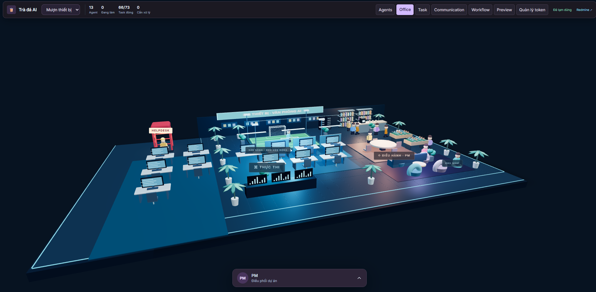

# Trà đá AI

Văn phòng 3D điều hành đội agent phát triển phần mềm: giao yêu cầu cho PM, quản lý Story/task trên Redmine, theo dõi trao đổi, kiểm thử và tích hợp code qua GitHub, xem Preview, quản lý agent và mức sử dụng token.



## Có những gì

- Tám vai trò gốc: PM, SA, BA, BE, FE, DEVOPS, REVIEW và TESTER.
- Office 3D, Focus, trạng thái làm việc, hiệu ứng bàn giao và Helpdesk lắp bàn cho agent mới.
- Task, Communication, Workflow, Preview và chọn dự án.
- Thêm/sửa/nhân bản/tạm dừng/lưu trữ/khôi phục agent; đồng bộ tài khoản Redmine riêng cho agent bổ sung.
- Cấu hình Codex CLI, Claude Code hoặc Gemini CLI theo agent; skill, công cụ và quyền cộng tác riêng.
- Dashboard token: usage theo agent/model/tháng, lịch sử và giới hạn tháng.
- Bot Discord theo vai trò, trao đổi công việc và báo cáo cuối ngày từ 18 giờ UTC+7.
- Quy trình nhánh riêng → triển khai → review → test → PR → CI → merge → cập nhật Preview, theo điều kiện chất lượng.

Đây là bản chạy local trên Windows. Codex có lịch sử vận hành chính; Claude/Gemini còn phụ thuộc tài khoản, quyền model và quota. Hồ sơ agent không phải tiến trình model chạy liên tục. Không cam kết tự khắc phục mọi lỗi, không tự đổi nhà cung cấp khi gặp lỗi. Chức năng phòng trà và nghiệm thu toàn chuỗi dự án mới còn cần hoàn thiện.

## Cấu trúc bộ mã nguồn

```text
agent-office/                 Giao diện React và Three.js
agent-service/lending/        Điều phối Trà đá AI, agent, Discord, token, preview
agent-service/                Thư viện điều phối dùng chung và phần TicketLab cũ
examples/club-equipment-lending/  Mã mẫu ứng dụng thực nghiệm, không có Git history
infra/                       Docker Compose và seed Redmine mới
deployment.example.json      Cấu hình triển khai không chứa bí mật
setup.ps1                    Chuẩn bị một máy Windows mới
start.ps1                    Chạy từng thành phần
```

Entrypoint của sản phẩm này là `/lending` và `agent-service/lending/office.py`. Không dùng hướng dẫn TicketLab cũ trong README thành phần để khởi động Trà đá AI. Phần giao diện kế thừa Agent Office; xem [ghi công](THIRD_PARTY_NOTICES.md).

## Yêu cầu trước khi cài

1. Windows 10/11, PowerShell 5.1+, Python 3.11+ có `venv`, Git for Windows và Git Credential Manager.
2. Node.js **26+** và npm cho ứng dụng thực nghiệm. Giao diện riêng có yêu cầu thấp hơn trong package.json.
3. Docker Desktop đang hoạt động, dùng Linux containers; đủ RAM/dung lượng cho Redmine và PostgreSQL.
4. Để agent làm việc thật: cài ít nhất một CLI nhà cung cấp và đăng nhập trên chính máy đó. Không có tài khoản hay quota được chia sẻ qua repository.
5. Để chạy demo SQL và kiểm thử tích hợp: SQL Server local instance `MSSQLSERVER`, Windows Authentication, Microsoft ODBC Driver **17**; có thể cần Visual Studio C++ Build Tools để dựng `msnodesqlv8`. SQL Server Express named instance cần điều chỉnh chuỗi kết nối trong các helper trước khi chạy.

Chỉ xem Office và cấu hình hồ sơ không bắt buộc bật Discord hoặc SQL. Tác vụ triển khai/kiểm thử cần đủ môi trường của dự án đích. Các cổng mặc định: Redmine `3000`, Office `8766`, backend `8767`, preview mẫu `3102`. Không cần dashboard TicketLab cũ ở cổng 8765 cho đường dẫn `/lending`.

## Cài trên máy mới

### 1. Tải mã và chuẩn bị repository ứng dụng

```powershell
git clone https://github.com/quanlm053-cpu/tra-da-AI.git
cd tra-da-AI
git credential-manager github login --device
```

Repository `tra-da-AI` là **nền tảng**, khác repository ứng dụng mà agent sửa. Tạo/fork một repository ứng dụng của bạn, có nhánh `main` và có ít nhất một commit. Có thể fork `quanlm053-cpu/club-equipment-lending`, hoặc đưa mã trong `examples/club-equipment-lending` lên một repo riêng. Tài khoản GitHub phải có quyền push, tạo PR và thao tác workflow trên repo đó.

### 2. Thiết lập dependency và Redmine riêng

```powershell
powershell -ExecutionPolicy Bypass -File .\setup.ps1 -AppRepository "TEN_TAI_KHOAN/REPO_UNG_DUNG"
```

Script tạo `.venv`, cài thư viện Discord, công cụ npm local, dependency giao diện, build UI, clone repo ứng dụng vào `workspace/app`, khởi động Redmine/PostgreSQL và tạo cấu hình local. Lần đầu tải Docker image có thể mất vài phút. Script dừng khi bước bắt buộc lỗi; xem thông báo thay vì tiếp tục khởi động backend.

**Redmine trong Compose phải là instance mới, dành riêng cho Trà đá AI.** Bản điều phối hiện dùng tracker/status ID cố định; seed tạo đúng ID, tám tài khoản nhận việc và workflow. Nó từ chối các project/ID xung đột, không dùng để sửa Redmine hiện có. Nếu cổng 3000 đang có Redmine khác, dừng thiết lập và lựa chọn cài ở môi trường riêng; không trỏ script vào dữ liệu đang dùng.

Sau cài đặt, mở `http://localhost:3000`. Tên đăng nhập admin và mật khẩu ngẫu nhiên nằm trong **`.local/credentials.json`** trên máy của bạn. File này cũng chứa API key của tài khoản dịch vụ; không gửi lên GitHub hoặc chia sẻ trong ảnh. Bot agent chỉ là người nhận issue, không dùng chung mật khẩu admin. Thay đổi mật khẩu admin qua giao diện nếu cần.

`deployment.local.json` chứa cấu hình dự án trên máy mới. `agent-service/config.json` chứa địa chỉ Redmine và đường dẫn file thông tin xác thực được script tạo cho máy đó. Các file này bị Git bỏ qua. Setup không mang theo Story, task, lịch sử chat, token, người dùng cá nhân hoặc DB từ máy tác giả.

### 3. Đăng nhập model

Codex: cài Codex CLI theo hướng dẫn của nhà cung cấp, đảm bảo `codex --version` chạy được rồi đăng nhập bằng `codex login`.

Claude/Gemini là tùy chọn:

```powershell
powershell -ExecutionPolicy Bypass -File .\agent-service\lending\provider.ps1 -Provider gemini -Action install
powershell -ExecutionPolicy Bypass -File .\agent-service\lending\provider.ps1 -Provider gemini -Action login
```

Thay `gemini` bằng `claude` nếu sử dụng Claude Code. API key cấu hình theo CLI hoặc biến môi trường nhà cung cấp; không đặt trong hướng dẫn agent hoặc tên model. Office → Agents → Runtime để chọn provider/model. Kiểm tra cài đặt chỉ xác nhận CLI/dấu hiệu đăng nhập; nút thử model/runtime mới gọi model và có thể tiêu token.

### 4. SQL Server cho ứng dụng mẫu

Trong SQL Server Management Studio, bằng tài khoản có quyền phù hợp, tạo **hai database thử nghiệm riêng**:

```sql
IF DB_ID(N'ClubEquipmentLending_Test') IS NULL
    CREATE DATABASE [ClubEquipmentLending_Test];
IF DB_ID(N'ClubEquipmentLending_Preview') IS NULL
    CREATE DATABASE [ClubEquipmentLending_Preview];
```

Cấp quyền thao tác/migration cho tài khoản Windows chạy dịch vụ trong hai DB trên. Không dùng DB nghiệp vụ thật. Với repo ứng dụng đã clone:

```powershell
cd workspace\app
npm.cmd ci
$env:SQLSERVER_DRIVER='odbc'
$env:DATABASE_URL='Driver={ODBC Driver 17 for SQL Server};Server=lpc:localhost;Database=ClubEquipmentLending_Preview;Trusted_Connection=yes;Encrypt=yes;TrustServerCertificate=yes;'
$env:LENDING_ENV='demo'
$env:DEMO_MEMBER_PASSWORD='THAY_BANG_MAT_KHAU_DEMO_CUA_BAN'
$env:DEMO_MANAGER_PASSWORD='THAY_BANG_MAT_KHAU_DEMO_KHAC'
npm.cmd run migrate
npm.cmd run seed
```

Tài khoản demo là `demo.member` / `demo.manager`, dùng mật khẩu bạn vừa đặt. Xem README của ứng dụng để kiểm tra migration và seed. Preview tích hợp dùng HTTP loopback riêng nên không cần Caddy cho cách chạy qua Office này. Luồng HTTPS độc lập trong README ứng dụng là lựa chọn khác.

## Khởi động mỗi ngày

Mở Docker Desktop, rồi từ thư mục gốc:

```powershell
docker compose --env-file infra/.env -f infra/compose.yaml up -d
```

Mỗi lệnh sau chạy trong **một PowerShell riêng**, giữ cửa sổ mở:

```powershell
.\start.ps1 -Component backend
.\start.ps1 -Component office
# Hai thành phần tùy chọn:
.\start.ps1 -Component preview
.\start.ps1 -Component discord
```

Mở **http://localhost:8766/lending**. Dự án mới bắt đầu ở trạng thái tạm dừng. Kiểm tra cấu hình rồi giao PM một yêu cầu hoặc nhắn “tiếp tục dự án” khi đã sẵn sàng. Dừng thành phần bằng Ctrl+C; phần đang làm có thể cần kiểm tra checkpoint khi khởi động lại. Tắt máy thì bot và điều phối dừng; repo không tự cung cấp máy chủ 24/7.

## Thiết lập Discord tùy chọn

1. Tạo server/kênh công việc trên Discord; tạo ứng dụng bot PM và các bot vai trò trong Developer Portal. Bật Message Content Intent khi luồng nhận nội dung yêu cầu; invite bot vào server với View Channels, Send Messages và Read Message History.
2. Bật Developer Mode trong Discord, sao chép server ID và channel ID. Điền `discord.guild_id`, `work_channel_id`, `tea_channel_id` trong `deployment.local.json`. Không dùng ID của server tác giả.
3. Chạy `start.ps1 -Component discord`, nhập token tại terminal khi được hỏi. Token được lưu trong Windows Credential Manager theo server ID, các lần sau không cần nhập lại.
4. Tag `@PM` trong kênh công việc và đợi câu trả lời; báo “đã nhận” chưa phải đã hoàn thành. Báo cáo cuối ngày gửi từ 18 giờ UTC+7 khi dịch vụ đang chạy. Chạy lại riêng Discord sau khi thêm bot mới; hồ sơ agent Office không tự tạo application Discord.

Không đăng token vào repo hoặc báo cáo. Kênh phòng trà có cấu hình nhưng trò chuyện tự phát ngoài lề chưa được nghiệm thu đầy đủ.

## Quản lý agent và token

Agents → thêm agent → điền Profile/Runtime/Capabilities/Collaboration → lưu → đợi đồng bộ Redmine → Kiểm tra & kích hoạt. Agent mới không tự thay vai trò gốc trong mọi workflow; giao cụ thể hoặc điều chỉnh người nhận trước khi bước đó chạy. Việc thêm/sửa hồ sơ không cần restart backend.

Quản lý token → bảng toàn đội → tên agent hoặc Đặt giới hạn. `0` là không giới hạn; 80% cảnh báo, đạt ngưỡng chặn lượt gọi mới. Lượt đang chạy không bị cắt nên có thể vượt ngưỡng. Khi đặt giới hạn, lượt thiếu usage cũng chặn lượt mới. Đây là thống kê runtime trong Office, chưa gồm phiên CLI bên ngoài/nút thử, không phải số dư tài khoản hay hóa đơn. Dữ liệu bắt đầu từ khi ghi nhận, không tự nhập lịch sử máy tác giả.

## Kiểm tra cài đặt và xử lý lỗi

```powershell
.\.venv\Scripts\python.exe -m unittest discover -s agent-service/lending -p "test_agent*.py"
.\.venv\Scripts\python.exe -m unittest discover -s agent-service/lending -p "test_token_usage.py"
npm.cmd --prefix agent-office run build
Invoke-RestMethod http://127.0.0.1:8767/lending-api/state
```

- Không mở được trang: kiểm tra đúng cổng và cửa sổ backend/Office; không dùng URL demo upstream để điều khiển máy local.
- Redmine lỗi 401/403: API key admin, REST API, quyền user/membership và file credentials local.
- Task chờ SA/BA/BE: phụ thuộc chưa bàn giao, không phải cứ thêm nhiều FE là chạy ngay.
- 429/quota/503: xem thông báo provider, chờ hoặc tự chọn model khác; hệ thống không tự chuyển tài khoản/provider.
- SQL/ODBC: đúng instance, Driver 17, quyền Windows, database riêng và native module. Không sao chép binary driver từ máy tác giả.
- Preview chưa mới: kiểm tra `origin/main`, dependency/build và `agent-service/runtime/lending/preview-server.log`.
- Sửa mã backend: restart backend; sửa UI khi dùng Vite sẽ tải lại. Không dừng database hay xóa Docker volume để “sửa” lỗi giao diện.

## Kiểm chứng và giới hạn gói phát hành

Mã nền tảng đã có các bài kiểm thử agent/provider/token và kiểm tra UI trong môi trường phát triển. Bản đóng gói được kiểm tra cú pháp, unit test và build; việc cài đầy đủ trên một Windows sạch với tài khoản/SQL riêng cần nghiệm thu tiếp. Redmine mới được kiểm tra trong Docker tách biệt: khởi tạo project, tám tài khoản gốc, trạng thái và đồng bộ tài khoản agent bổ sung không tạo trùng. Không chạy seed trên Redmine đang dùng của tác giả. SQL và toàn bộ luồng setup trên một Windows sạch vẫn cần kiểm chứng riêng. Adapter Claude/Gemini không đồng nghĩa mọi model/tài khoản đã được nghiệm thu.

Repo cung cấp toàn bộ **mã nguồn** nền tảng và snapshot ứng dụng mẫu, không phải ảnh sao chép ổ đĩa: dependency, binary đã cài, DB, log, checkpoint, cache, lịch sử chat và thông tin đăng nhập được tạo lại trên máy triển khai. Không có tự động deploy production, tự khởi động cùng Windows hay đồng bộ secret từ máy khác.
